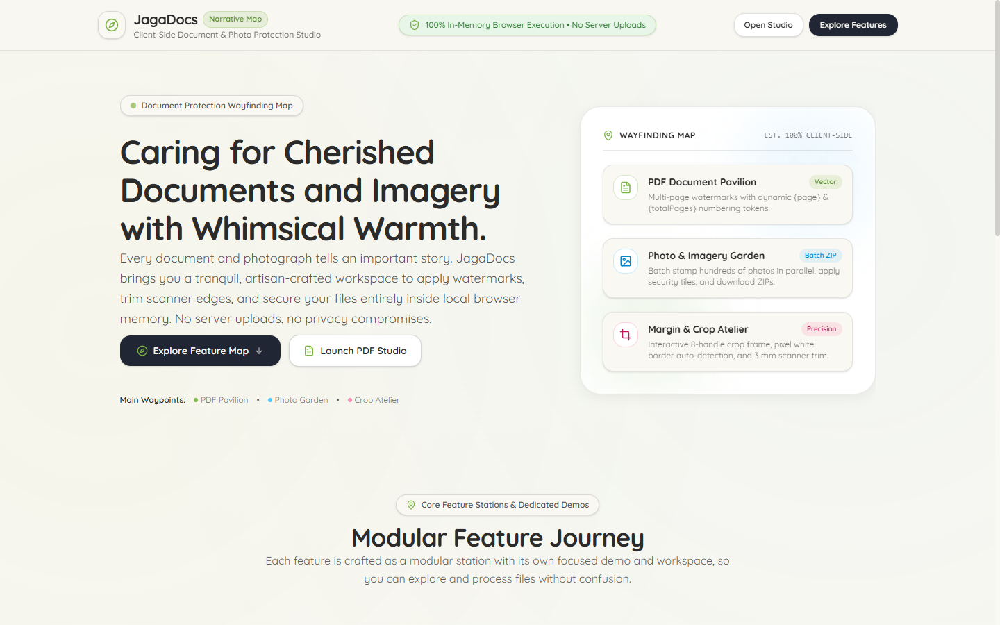
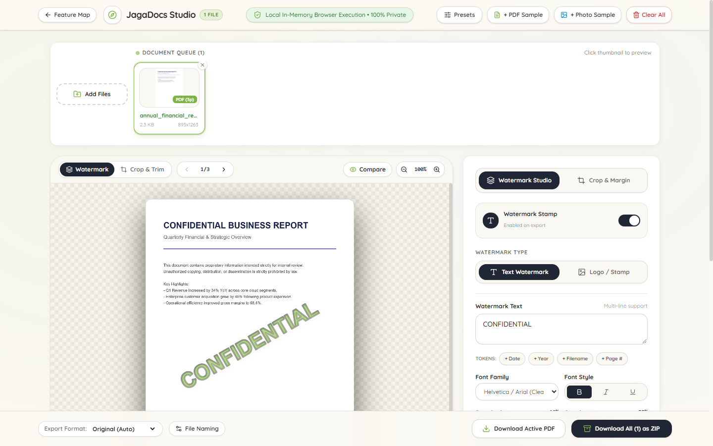
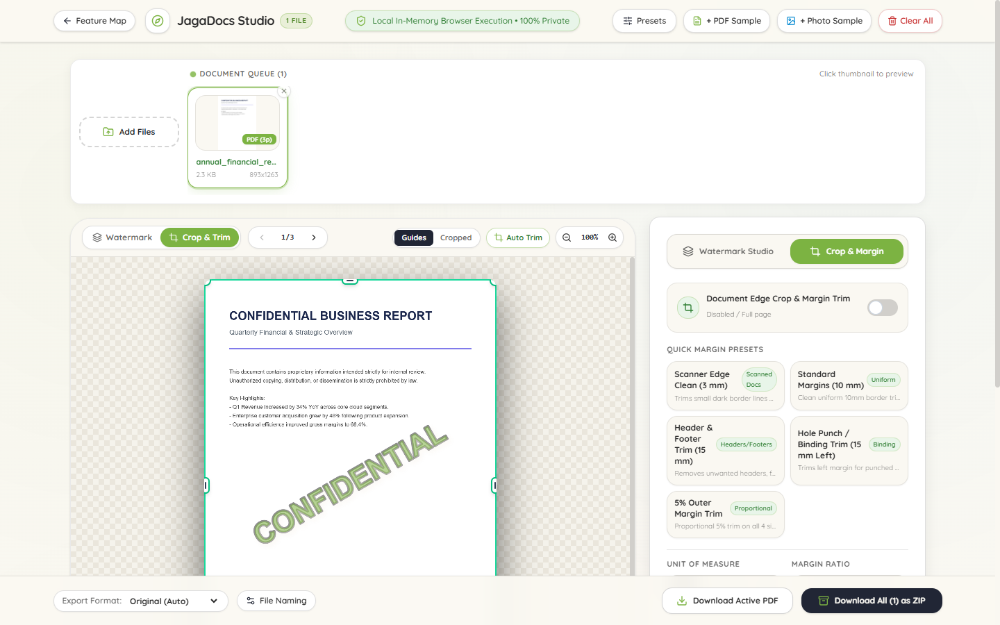

# JagaDocs: Ghibli-Inspired Narrative Map Document & Photo Studio

[](LICENSE)
[](https://react.dev/)
[](https://www.typescriptlang.org/)
[](https://tailwindcss.com/)
[](#privacy-guarantee)

**JagaDocs** is an artisan-crafted, privacy-first web application designed with a **Ghibli-inspired narrative map interface**. It enables modular batch watermarking, multi-page vector PDF protection, and precision document edge/margin trimming. All file manipulation executes 100% locally inside browser memory (HTML5 Canvas & WebAssembly) with zero server uploads.

---

## Interface & Visual Tour

<p align="center">
  
</p>
<p align="center"><em>1. Narrative Map Landing: Wayfinding through wonder with dedicated station waypoints.</em></p>

<br/>

<p align="center">
  
</p>
<p align="center"><em>2. Multi-Page Vector PDF Studio: Real-time preview canvas, typography controls, and dynamic numbering tokens.</em></p>

<br/>

<p align="center">
  
</p>
<p align="center"><em>3. Margin & Crop Atelier: Interactive 8-handle frame, auto-detection, and standard margin presets.</em></p>

---

## Modular Feature Architecture

Instead of merging unrelated tools into a single crowded screen, JagaDocs organizes each capability as an independent **Feature Module** registered in `src/modules/featureRegistry.ts`:

### 1. PDF Document Pavilion (`pdf-watermark`)
- **Native Vector Watermarks**: Embeds crisp scalable vector text and transparent stamps into PDF streams without rasterization.
- **Dedicated Demo**: Instant 3-page business report demo with dynamic `{page}` and `{totalPages}` tokens.
- **Page Range Selector**: Apply watermarks to All Pages, First Page Only, Last Page Only, or Custom Ranges (`1, 3-5, 8`).

### 2. Photo & Imagery Garden (`image-watermark`)
- **High-Resolution Batch Processing**: Watermark hundreds of photos in parallel (PNG, JPG, WebP, SVG, BMP).
- **Dedicated Demo**: High-resolution landscape photo asset (1200x800 px) to test opacity, tilt angle, and badge styles.
- **Security Tile Matrix**: Seamless repeating watermark patterns with custom horizontal/vertical spacing and diagonal offsets.
- **Instant ZIP Export**: Download all watermarked photos in an organized `.zip` archive via JSZip.

### 3. Margin & Crop Atelier (`doc-crop`)
- **Interactive 8-Handle Crop Frame**: Drag corners, edges, or the entire frame directly on the canvas.
- **Dedicated Demo**: Scanned document sample for one-click margin cleanup testing.
- **Multi-Unit Precision**: Adjust margin trims in `mm`, `pt`, `%`, or `px`.
- **Pixel White Border Auto-Detection**: Analyzes page pixel data in real time to crop scanner noise and blank margins.
- **Native PDF Box Vector Crop**: Updates `MediaBox`, `CropBox`, `TrimBox`, and `BleedBox` in PDF binary streams.

---

## Ghibli Narrative Design System

| Element | Specification |
|---|---|
| **Palette** | Parchment (`#FAF8F2`), Charcoal Text (`#2B2B2B`), Deep Slate Navy (`#212635`), Grass Green (`#7CB342`), Sky Blue (`#4FC3F7`), Soft Blossom Pink (`#F48FB1`) |
| **Typography** | `Quicksand` (Display Hero 700, Body 400, UI Labels 500) + `JetBrains Mono` (Technical values) |
| **Shapes** | Friendly rounded scale: `sm: 15px`, `md: 30px`, `lg: 45px` |
| **Elevation** | Warm diffuse ambient lighting, subtle shadow (`0 2px 12px rgba(0,0,0,0.06)`), 1px organic pencil border |
| **Craftsmanship** | Strictly compliant with Anti-Slop Core rules: zero generic neon glows, zero template card spam, zero em dashes |

---

## Privacy Guarantee

All image processing and PDF transformations execute **100% locally in browser memory**:

- Zero server uploads
- Zero remote database storage
- Zero telemetry tracking on uploaded document contents
- Completely offline capable after initial page load

---

## Getting Started

```bash
# Clone the repository
git clone https://github.com/jagadocs/jagadocs.git
cd jagadocs

# Switch to the redesign branch
git checkout feature/ghibli-modular-redesign

# Install dependencies
npm install

# Start development server
npm run dev

# Build for production
npm run build
```
