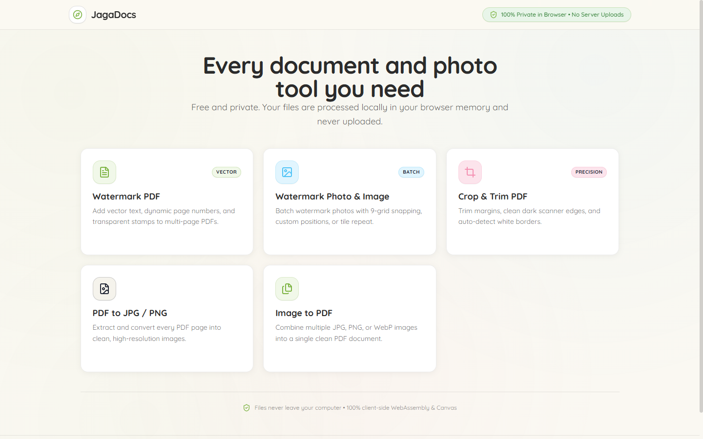
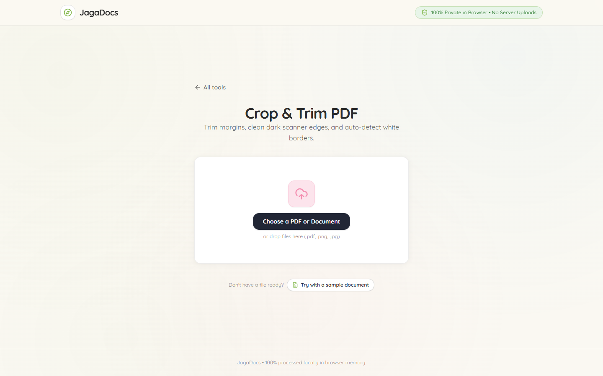
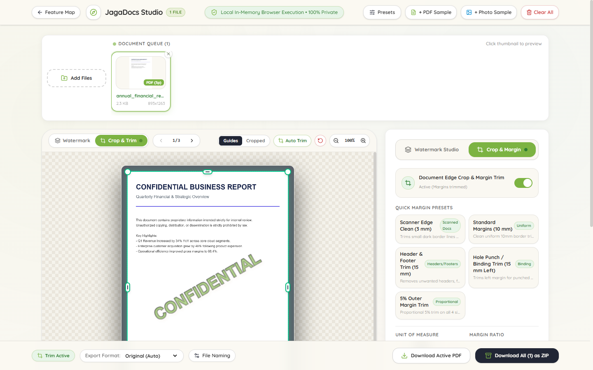

# JagaDocs: Private Client-Side Document & Photo Suite

[](LICENSE)
[](https://react.dev/)
[](https://www.typescriptlang.org/)
[](https://tailwindcss.com/)
[](#privacy-guarantee)

**JagaDocs** is an elegant, modular document and photo utility suite (inspired by [PdfBar](https://pdfbar.netlify.app/) and styled with warm Ghibli parchment aesthetics). It features dedicated, independent tool pages for multi-page vector PDF watermarking, batch photo watermarking, and precision document margin/crop trimming. All processing executes 100% locally in browser memory (WebAssembly & HTML5 Canvas) with zero server uploads.

---

## Visual Tour

<p align="center">
  
</p>
<p align="center"><em>1. All Tools Home: Clean, direct grid of tools with immediate access and zero clutter.</em></p>

<br/>

<p align="center">
  
</p>
<p align="center"><em>2. Dedicated Tool Page: Direct file dropzone with one-click sample loader for instant testing.</em></p>

<br/>

<p align="center">
  
</p>
<p align="center"><em>3. Interactive Studio Workspace: Real-time preview canvas, margin controls, and bottom export actions.</em></p>

---

## Available Modular Tools

Every capability operates as a dedicated module registered in `src/modules/featureRegistry.ts`:

1. **Watermark PDF** (`#/watermark-pdf`)
   - Embeds scalable vector text, transparent logos, and dynamic numbering tokens (`{page}`, `{totalPages}`) into PDF content streams.
   - Dedicated 3-page sample report for instant testing.

2. **Watermark Photo & Image** (`#/watermark-image`)
   - Batch watermark photos with 9-grid snapping, freeform canvas drag, or repeating security tile matrices.
   - Dedicated high-resolution landscape photo demo (1200x800).
   - Package all results in a single organized ZIP archive.

3. **Crop & Trim PDF** (`#/crop-pdf`)
   - Interactive 8-handle crop frame on canvas to trim scanner noise, binding punch margins, or blank borders.
   - Pixel-based white border auto-detection and 1-click presets (Scanner Clean 3mm, Standard 10mm, Binding 15mm).

4. **PDF to JPG / PNG** (`#/pdf-to-image`)
   - Export and convert every PDF page into clean, crisp image assets.

5. **Image to PDF** (`#/image-to-pdf`)
   - Combine multiple photos and graphics into a single clean PDF document.

---

## Privacy Guarantee

All document transformations execute **100% locally in browser memory**:

- Zero server uploads
- Zero remote database storage
- Zero telemetry tracking on uploaded document contents
- Completely offline capable after initial page load

---

## Development

```bash
# Clone the repository
git clone https://github.com/akbarrahmatm/jagadocs.git
cd jagadocs

# Switch to the branch
git checkout feature/ghibli-modular-redesign

# Install dependencies
npm install

# Start development server
npm run dev

# Build for production
npm run build
```
